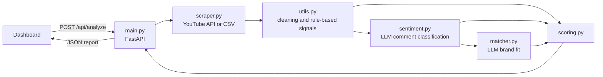

# Micro-Influencer Audience Quality & Brand-Fit Analyzer


A web app that helps a brand decide whether a creator is worth a partnership. Enter a YouTube channel (or upload comments from any platform) and describe your product. The app reports how real and engaged the audience is, how well the creator fits your product, and what a sponsored video would cost per quality engagement.


## Try it in 30 seconds (no API keys)

```bash
git clone https://github.com/lelentandane/influencer-sentiment-analyzer.git
cd influencer-sentiment-analyzer
python -m venv venv && source venv/bin/activate   # Windows: venv\Scripts\activate
pip install -r requirements.txt
cd backend && uvicorn main:app --reload
```

Open **http://localhost:8000** and select **See a sample report**. Live analysis needs the API keys described under Getting started.

## What you get

- **Audience quality:** an AI model classifies a sample of recent comments (supportive, question, critical, generic, spam, toxic) and rule-based checks flag repeated templates and promotional links. These combine into an Audience Trust Score.
- **Engagement health:** views per subscriber, likes and comments per 1,000 views, posting frequency and view consistency, each compared with a benchmark.
- **Brand fit:** an AI model compares the creator's description, recent video titles and audience topics with your product, then lists strengths, risks and a collaboration idea.
- **Cost per quality engagement:** enter the creator's fee to see what each like or comment would cost after discounting spam and templated comments.
- **A built-in sample report,** so the interface can be explored without any API keys.

## How it works



### Scoring

| Component | Weight | Method |
|---|---|---|
| Audience quality | 40% | Depth 50%, authenticity 35%, civility 15% |
| Brand fit | 35% | LLM score against a fixed rubric |
| Engagement health | 25% | Average of reach, interaction, conversation and consistency scores |

- **Depth:** share of comments that are specific and human (supportive, questions, critical).
- **Authenticity:** one minus the share that is spam or a repeated template.
- **Civility:** one minus the share that is toxic.
- **Cost per quality engagement:** `fee / (typical views x (likes + comments per view) x authenticity)`.

If a component cannot be measured (for example, engagement in CSV mode), it is left out and the remaining weights are rescaled. Benchmarks and weights live in `scoring.py` and `sentiment.py`.

### Design decisions

- **Official data only.** Channel and comment data come from the YouTube Data API. Other platforms are supported through CSV upload instead of scraping pages that forbid it.
- **Honest naming.** The app measures audience quality and brand fit. It does not claim to detect fake followers or predict ROI, which public data cannot support.
- **Rules where rules work.** Spam links, repeated templates and engagement ratios are computed in code. The LLM handles judgment calls and returns structured output through a tool schema.
- **Transparent scores.** Every score is shown with its components and an in-app explanation of the formula.

## Tech stack

| Layer | Tools |
|---|---|
| Backend | Python 3.10+, FastAPI, Uvicorn |
| Data | Pandas, requests, YouTube Data API v3 |
| AI | Anthropic Claude API (structured output via forced tool use) |
| Frontend | HTML, CSS, vanilla JavaScript, Chart.js (bundled locally) |

## Project structure

```
influencer-sentiment-analyzer/
├── backend/
│   ├── main.py          # FastAPI app: /api/analyze, /api/sample, /api/status
│   ├── scraper.py       # YouTube API client and CSV loader
│   ├── utils.py         # Cleaning, rule-based comment signals, engagement metrics
│   ├── sentiment.py     # LLM comment classification and trust score
│   ├── matcher.py       # LLM brand-fit analysis
│   ├── scoring.py       # Engagement health, cost metric, overall score
│   └── sample_data.py   # Demo report for the interface
├── frontend/
│   ├── index.html       # Guided input form and results layout
│   ├── style.css        # Styling, light and dark themes
│   ├── app.js           # Form handling, safe rendering, charts
│   ├── sample-comments.csv
│   ├── fonts/           # Bundled Figtree (OFL)
│   └── vendor/chart.umd.js
├── tests/               # pytest suite
├── docs/screenshots/
├── requirements.txt
├── requirements-dev.txt
└── README.md
```

## Getting started

### Prerequisites

- Python 3.10 or newer
- An [Anthropic API key](https://console.anthropic.com/)
- A free YouTube Data API key (only needed to analyze YouTube channels):
  1. Create a project in the [Google Cloud Console](https://console.cloud.google.com/).
  2. Enable **YouTube Data API v3** for the project.
  3. Create an API key under **APIs & Services > Credentials**.

### Setup

```bash
git clone https://github.com/lelentandane/influencer-sentiment-analyzer.git
cd influencer-sentiment-analyzer

python -m venv venv
source venv/bin/activate        # Windows: venv\Scripts\activate

pip install -r requirements.txt

export ANTHROPIC_API_KEY="your-anthropic-key"
export YOUTUBE_API_KEY="your-youtube-key"
# Windows (PowerShell): $env:ANTHROPIC_API_KEY="..."; $env:YOUTUBE_API_KEY="..."
```

### Run

```bash
cd backend
uvicorn main:app --reload
```

Open **http://localhost:8000**.

### Configuration

| Variable | Required | Default | Purpose |
|---|---|---|---|
| `ANTHROPIC_API_KEY` | For live analysis | none | Comment classification and brand fit |
| `YOUTUBE_API_KEY` | For YouTube mode | none | Channel, video and comment data |
| `SENTIMENT_MODEL` | No | `claude-haiku-4-5-20251001` | Model for comment classification |
| `MATCHER_MODEL` | No | `claude-sonnet-5-5` | Model for brand fit |
| `RATE_LIMIT_PER_HOUR` | No | `10` | Analyses allowed per IP address per hour |

## Using the app

1. **Choose a source.** For YouTube, paste a channel handle (such as `@channelname`) or link. For any other platform, upload a CSV with one comment per row. Only a column named `comment` or `text` is required; `author`, `likes` and `date` are optional. An example file is available in the app.
2. **Describe your product** in a sentence or two. Optionally add who you want to reach.
3. **Optionally enter the creator's fee** to get a cost estimate (YouTube mode).
4. Select **See a sample report** at any time to preview the output without running an analysis.

A YouTube analysis reads the 10 most recent videos and up to 100 recent top-level comments on each of the 5 newest, and uses about 8 units of the default 10,000 daily YouTube API quota.

## API

| Endpoint | Method | Purpose |
|---|---|---|
| `/api/analyze` | POST (multipart form) | Run an analysis. Fields: `mode` (`youtube` or `csv`), `creator`, `creator_description`, `brand_description`, `target_audience`, `fee`, `comments_file` |
| `/api/sample` | GET | Demo report, flagged `is_sample: true` |
| `/api/status` | GET | Which API keys the server has configured |

**Status codes for `/api/analyze`:** `200` success, `400` unreadable CSV or unsupported channel link, `404` channel not found, `422` invalid input, `429` rate limit or YouTube quota reached, `502` upstream service error, `503` missing API key.

## Tests

```bash
pip install -r requirements-dev.txt
pytest
```

The suite covers the scoring formulas and labels, comment cleaning and spam, duplicate and generic detection, engagement metrics, YouTube link parsing, CSV loading, the trust score and the API (input validation, missing keys, a full CSV analysis and the rate limiter), with the AI calls replaced by fakes. It runs on every push through GitHub Actions.

## Security and privacy

- **Commenter privacy:** commenter identities are hashed on ingest and raw names are never kept. Nothing is stored between requests.
- **API key safety:** network errors are replaced with generic messages so request URLs containing a key never reach the client.
- **Prompt injection:** comments and creator descriptions are untrusted. They are delimited in the prompt and the model is instructed to analyze them, never follow them.
- **XSS:** the frontend inserts all report text with `textContent`, never `innerHTML`.
- **Resource limits:** uploads are capped at 5 MB and 5,000 rows, and analyses are rate limited per IP address.

## Limitations and scope

**Data**
- Analysis covers recent top-level comments on the latest videos. It is a snapshot, not a long-term trend, and replies are not included.
- Audience measures are indicators. Public data cannot prove whether followers are real or purchased.
- Only YouTube has direct integration. Other platforms require a CSV export, and engagement metrics and cost estimates are unavailable in that mode.
- Spam and generic-comment word lists are English only.

**Scoring**
- Weights, benchmarks and the trust formula are transparent defaults, not calibrated industry standards. Scores are best used to compare creators and spot problems.
- AI-generated labels and brand-fit scores can vary by a few points between runs, and their agreement with human judgment has not yet been measured.
- The cost estimate assumes a sponsored video performs like a typical recent video.

**Deployment**
- The in-memory rate limiter is per process and resets on restart. Behind a reverse proxy, use a proxy-aware limiter.
- There is no caching, so repeating an analysis repeats the API cost.

## Roadmap

- [ ] Measure label accuracy against a hand-labeled comment set
- [x] Automated tests (pytest) for parsers, scoring and the API
- [ ] Result caching
- [ ] Compare several creators side by side
- [ ] Export the report as PDF
- [ ] Docker setup

## License

MIT. See `LICENSE`. Chart.js is bundled under its own MIT license (`frontend/vendor/chart.js-LICENSE.md`).

## Author

**Sphelele Ntandane**
[GitHub](https://github.com/lelentandane) | [LinkedIn](https://www.linkedin.com/in/lelentandane)
